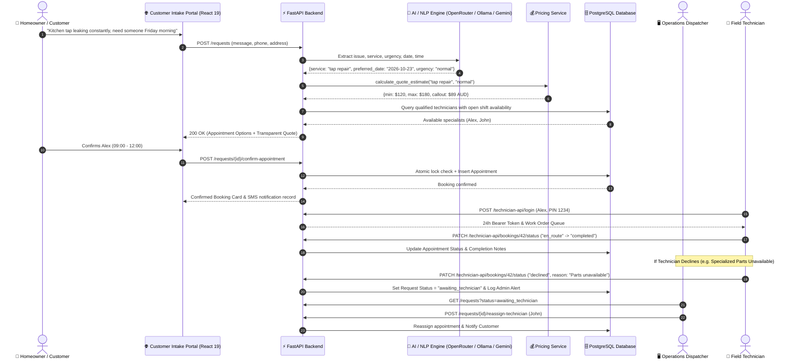
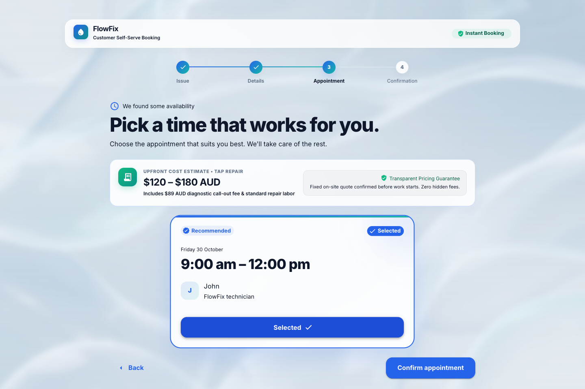
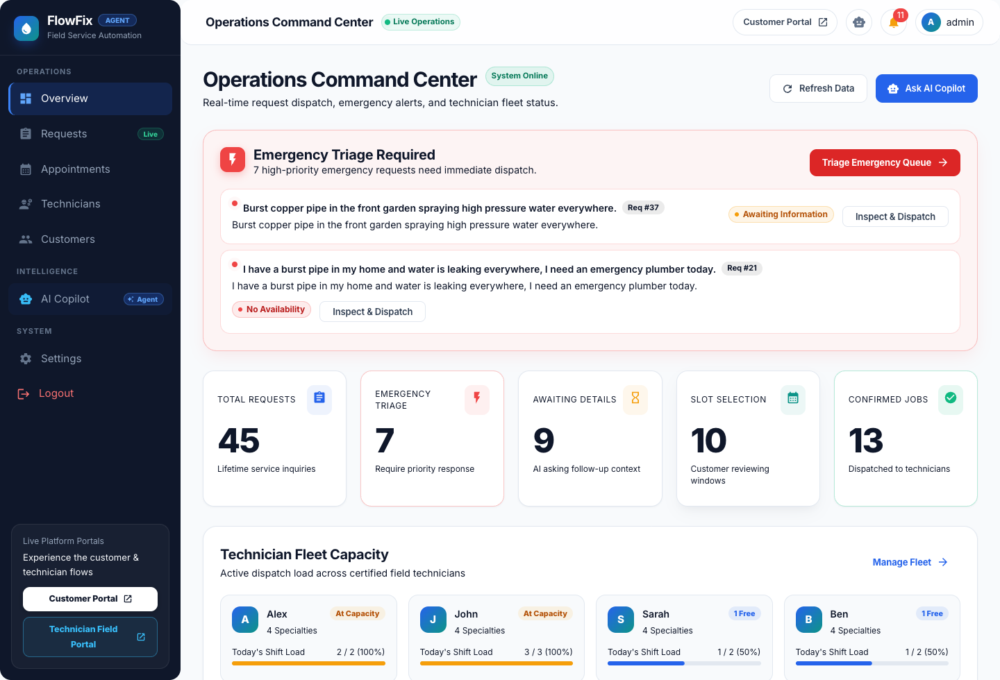
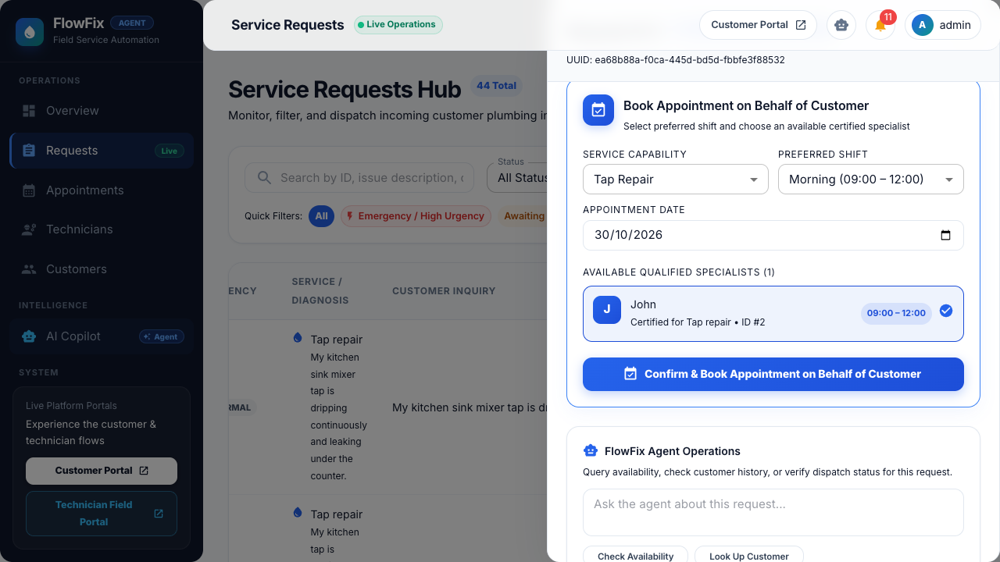
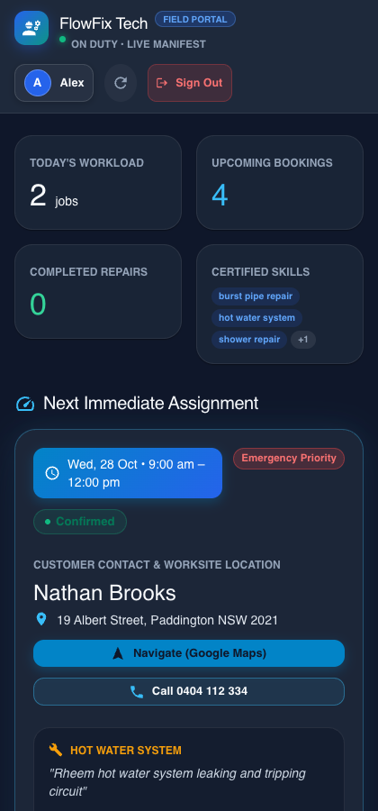
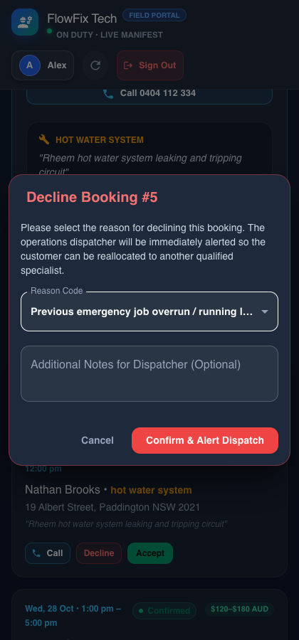

# FlowFix AI: Autonomous Plumbing Dispatch & Field Operations Platform

> An autonomous dispatch and field operations platform engineered for plumbing and trade service businesses, synchronizing conversational customer intake, dispatcher operations, and mobile field execution.

Trade and field service businesses face severe operational bottlenecks: missed customer calls, slow quote turnarounds, manual dispatch overhead, and high friction in scheduling. **FlowFix AI** automates this end-to-end lifecycle across three synchronized interfaces: an AI intake agent diagnoses plumbing emergencies from natural language, resolves certified trade specialties, and estimates upfront quotes; an operations command center gives dispatchers real-time fleet capacity, SLA monitors, and race-condition-safe booking controls; and a mobile-first field technician portal equips tradespeople with PIN authentication, one-tap calling, turn-by-turn navigation, and audited decline-and-redispatch routing.

---

## Headline Capabilities & Operational Highlights

* **Tri-Party Operational Synchronization**: Real-time coordination across Customer Intake (`/customer-portal`), Operations Command Center (`/`), and Mobile Field Technician Portal (`/technician/login`) over a unified FastAPI / PostgreSQL state machine.
* **Conversational AI Diagnosis & Trade Resolution**: Normalizes free-text customer symptom descriptions into 10 certified plumbing trade domains (`tap repair`, `blocked drains`, `hot water system`, `burst pipe repair`, `gas fitting`, `roof plumbing`, `backflow prevention`, etc.).
* **Transparent Upfront Tiered Pricing Engine**: Dynamically calculates upfront cost breakdowns (trade base rate, $89 callout fee, and emergency surcharges) calibrated to standard Australian trade rates before booking confirmation.
* **Atomic Double-Booking Prevention**: Transaction-safe slot reservations enforce database-level isolation locks with atomic rollback, preventing race conditions when multiple customers or dispatchers select identical time slots.
* **Audited Decline-and-Redispatch Workflow**: When a technician in the field declines a work order (e.g. specialized parts unavailable or schedule conflict), the job is automatically rolled back to `awaiting_technician` and triggers a high-priority dispatcher alert for immediate redeployment.
* **Automated 35-Day Shift Provisioning**: Automatically generates rolling 35-day morning (`09:00–12:00`) and afternoon (`13:00–17:00`) availability windows whenever field technicians are onboarded.
* **Comprehensive Test Suite**: Automated tests across 11 modules covering NLP extraction, pricing rules, concurrency safety, and mobile technician lifecycles.

---

## System Architecture & Tri-Party Data Flow



---

## Visual Interface Tour

### 1. Customer Self-Serve Intake & Upfront Quote Estimation

*Customer intake screen displaying natural language problem entry, trade badge (`tap repair`), and upfront quote breakdown.*

### 2. Operations Command Center (Dispatcher Dashboard)

*Operations dashboard showing fleet workload cards, active request pipeline, and urgency badges.*

### 3. Direct Specialist Booking & Reassignment Drawer

*Direct booking drawer showing qualified specialist availability filtered by morning/afternoon shift slots.*

### 4. Field Technician Mobile Portal & Decline Workflow
<p align="center">
  
  
</p>
*Left: Field technician mobile view highlighting the "Up Next" work order, one-tap calling, Google Maps navigation button, and status progression buttons. Right: Modal showing technician decline reason selection and the corresponding dispatcher re-dispatch alert.*

---

## The Three Operational Portals

### 1. Conversational Customer Intake Portal (`/customer-portal`)
* **Natural Language Diagnosis**: Customers describe plumbing problems in free text (*"my kitchen mixer tap is dripping constantly"*, *"no hot water from the tank"*, or *"water spraying from pipe"*).
* **Deterministic & LLM Date/Time Math**: Resolves relative calendar language (*"tomorrow morning"*, *"Friday 23 Oct"*, *"asap"*, *"first available slot"*) into strict ISO timestamps without hallucinated drift.
* **Transparent Upfront Quotes**: Displays clear price ranges and callout fees before the customer commits to an appointment.
* **OpenStreetMap Autocomplete**: 100% free and open-source address geocoding powered by OpenStreetMap Nominatim.

### 2. Operations Command Center (`/` or `/login`)
* **Fleet Workload Monitor**: Live capacity indicators showing shift utilization percentages, active job allocations, and trade certifications.
* **Direct Admin Booking Drawer**: Dispatchers can inspect any service request, view real-time qualified specialist availability, filter by trade capability and shift window (morning / afternoon), and book or reschedule appointments with race condition protection.
* **Awaiting Technician & Re-Dispatch Queue**: Prominently highlights jobs requiring redeployment (e.g., when a field technician declines a work order), showing technician names alongside IDs for instant reassignment.
* **Onboard Field Specialists**: Interactive technician registration modal with certified trade multi-select and automated 35-day shift provisioning.
* **Autonomous Operations Copilot**: Natural language administrative assistant capable of querying fleet capacity, inspecting job histories, and reallocating emergency bookings via tool execution.

### 3. Mobile-First Field Technician Portal (`/technician/login`)
* **PIN Authentication & Demo Switcher**: Fast, secure mobile sign-in using technician name/ID and PIN (`1234`), featuring an instant demo switcher for evaluating multiple fleet members.
* **"Up Next" Work Order Hero**: High-visibility card highlighting the active job with urgency badges, arrival window countdown, customer contact details, and job description.
* **Direct Action Triggers**:
  - **One-Tap Phone Call**: Initiates immediate phone call (`tel:`) to customer.
  - **GPS Navigation**: Launches Google Maps turn-by-turn navigation directly to job address.
* **Work Order Status Progression**: Step-by-step progress buttons:
  - `Accept Job` $\to$ `En Route` $\to$ `In Progress` $\to$ `Complete Work Order`
* **Audited Job Decline Flow**: Technicians can decline with pre-categorized reasons (*Schedule Conflict*, *Outside Service Area*, *Specialized Parts Unavailable*, *Emergency*, or custom notes), instantly re-routing the request to `awaiting_technician` and raising a high-priority dispatcher alert.

---

## Dynamic Tiered Pricing Engine

Calibrated to standard Australian trade rates ([`app/services/pricing_service.py`](app/services/pricing_service.py)):

| Plumbing Trade Domain | Complexity | Base Estimate (AUD) | Typical Duration |
| :--- | :--- | :--- | :--- |
| **Tap Repair** | Standard | $120 – $180 | 1.5 hrs |
| **Toilet Repair** | Standard | $140 – $220 | 1.5 hrs |
| **Shower Repair** | Standard | $150 – $240 | 2.0 hrs |
| **Leak Investigation** | Intermediate | $180 – $320 | 2.0 hrs |
| **Blocked Drains** | Intermediate | $190 – $350 | 2.0 hrs |
| **Hot Water System** | Advanced | $280 – $650 | 3.0 hrs |
| **Burst Pipe Repair** | Critical / Emergency | $320 – $750 | 3.0 hrs |
| **Gas Fitting** | Licensed Specialist | $220 – $480 | 2.5 hrs |
| **Roof Plumbing** | Licensed Specialist | $250 – $550 | 3.0 hrs |
| **Backflow Prevention** | Certified Specialist | $200 – $420 | 2.0 hrs |

* **Standard Callout Fee**: $89 AUD callout fee included in quote breakdown.
* **High Urgency Surcharge**: $80 AUD emergency dispatch surcharge applied automatically to urgent leaks and burst pipes.

---

## Tech Stack

| Layer | Component | Details |
| :--- | :--- | :--- |
| **Backend API** | **FastAPI**, **Python 3.11+**, **SQLAlchemy 2.0**, **Alembic** | Async endpoints, dependency injection, and declarative ORM models |
| **Database** | **PostgreSQL 17** (`psycopg3`) / **SQLite** (Test mode) | Relational database with transaction isolation and foreign keys |
| **AI / NLP** | **OpenRouter**, **Ollama**, **Google Gemini** | Multi-provider abstraction (`meta-llama/llama-3.3-70b-instruct:free`, `qwen2.5:3b`) + deterministic date engine |
| **Frontend** | **React 19.2**, **Vite 8.2**, **Material-UI v9.3** | Dual design themes: Sapphire/Slate (Admin) & High-Contrast Emerald/Amber (Technician) |
| **Routing & Motion** | **React Router 7**, **Framer Motion** | Multi-portal routing, animated transitions, and mobile drawer flows |
| **Security & Auth** | **JWT Bearer**, **Passlib (Bcrypt)** | Role-Based Access Control (`operations`, `admin`, `tech`) with 24h tokens |
| **Geocoding** | **OpenStreetMap Nominatim** | Zero-cost, privacy-friendly address lookup and autocomplete |
| **Testing** | **Pytest 9**, **FastAPI TestClient** | Automated unit and integration test suite across 11 modules |

---

## Quickstart

### Prerequisites
* Python 3.11+
* Node.js 18+ and npm
* Docker & Docker Compose (for PostgreSQL)

### 1. Clone & Environment Setup
```bash
git clone https://github.com/IAMSHIVAM19/Flowfix-Agent.git
cd Flowfix-Agent

# Copy environment variable template
cp .env.example .env
```

### 2. Start PostgreSQL Database
```bash
docker compose up -d
```
*(Alternatively, for local development or testing without Docker, set `DATABASE_URL=sqlite:///flowfix.db` in your `.env` file).*

### 3. Setup Python Virtual Environment & Dependencies
```bash
python3.11 -m venv .venv
source .venv/bin/activate
pip install -r requirements.txt
```

### 4. Run Database Migrations & Initial Seed
```bash
# Apply schema migrations
alembic upgrade head

# Seed 10 certified plumbing trades, specialists with PINs, 35-day shifts, and demo requests
python -m app.seed
```

### 5. Start Backend API
```bash
uvicorn app.main:app --host 127.0.0.1 --port 8000 --reload
```
Interactive Swagger documentation will be available at: **[http://127.0.0.1:8000/docs](http://127.0.0.1:8000/docs)**.

### 6. Start Frontend Development Server
In another terminal window:
```bash
cd frontend
npm install
npm run dev
```
Open **[http://localhost:5173](http://localhost:5173)** (or `http://localhost:5174`) in your browser.

---

## Access Portals & Default Credentials

| Portal | URL Path | Target Persona | Credentials / Access |
| :--- | :--- | :--- | :--- |
| **Operations Command Center** | `/` (or `/login`) | Dispatchers & Fleet Managers | Username: `admin`<br>Password: `change-me-now` |
| **Field Technician Portal** | `/technician/login` | Mobile Tradespeople | Tech: `Alex`, `John`, or `Sarah`<br>PIN: `1234` *(Includes 1-click switcher)* |
| **Customer Intake Portal** | `/customer-portal` | Public Homeowners | Public self-serve (No login required) |
| **Interactive API Docs** | `/docs` | Developers & Integrators | Open OpenAPI / Swagger documentation |

---

## Running Automated Tests

Run the pytest suite:
```bash
pytest tests/ -v
```

To run pricing and extraction tests without requiring a running database:
```bash
DATABASE_URL="sqlite:///:memory:" pytest tests/test_pricing.py tests/test_openrouter.py -v
```

---

## Key Design Decisions & Limitations

### Design Decisions
* **Decoupled NLP Extraction and Deterministic Date Math**: Pure LLMs frequently make subtle calendar errors (e.g. converting "next Friday" to an incorrect date). FlowFix uses the LLM solely to extract raw intent strings and entities, which are then passed to a deterministic Python calendar engine to calculate exact ISO timestamps and validate weekday alignment.
* **Separation of Concerns Across Portals**: Rather than cramming dispatch and field workflows into a single interface, FlowFix provides three strictly dedicated UIs: a customer-facing frictionless stepper, a high-density operations command center with real-time drawer interactions, and an outdoor high-contrast, thumb-friendly mobile portal for tradespeople.
* **Audited Decline-and-Redispatch Lifecycle**: In field operations, a technician declining a job is an operational reality. Instead of dropping the booking into an unhandled state, the backend transitions the request to `awaiting_technician`, records decline reasons in audit logs, and triggers a dispatcher notification for prompt reallocation.
* **Atomic Concurrency Protection**: Database transactions check slot reservation status before inserting appointments. If two customers attempt to book the same specialist slot simultaneously, the second transaction is rolled back cleanly.

### Limitations
* **Geocoding Rate Limits**: The development build uses OpenStreetMap Nominatim for free address autocomplete, which enforces a rate limit (1 request/second). Enterprise production deployments require a paid provider (such as Google Places or Mapbox).
* **SMS Gateway Integration**: Customer booking confirmations and technician arrival alerts currently generate database notification records; live SMS transmission requires connecting a Twilio or MessageMedia webhook.
* **Local vs Cloud LLM Latency**: When running against local Ollama (`qwen2.5:3b`), extraction latency depends on host hardware (1-2s on Apple Silicon). In high-throughput settings, cloud endpoints (OpenRouter/Groq) are recommended.

---

## Visual Demo Placeholders

To add platform screenshots to the repository, capture and store the following assets in `docs/screenshots/`:

* `docs/screenshots/customer_booking_flow.png`: Customer intake screen displaying natural language problem entry, trade badge (`tap repair`), and upfront quote breakdown.
* `docs/screenshots/dispatcher_command_center.png`: Operations dashboard showing fleet workload cards, active request pipeline, and urgency badges.
* `docs/screenshots/admin_booking_drawer.png`: Direct booking drawer showing qualified specialist availability filtered by morning/afternoon shift slots.
* `docs/screenshots/technician_mobile_portal.png`: Field technician mobile view highlighting the "Up Next" work order, one-tap calling, Google Maps navigation button, and status progression buttons.
* `docs/screenshots/decline_redispatch_flow.png`: Modal showing technician decline reason selection and the corresponding dispatcher re-dispatch alert.

---

## License

Distributed under the MIT License. See [LICENSE](LICENSE) for details.
